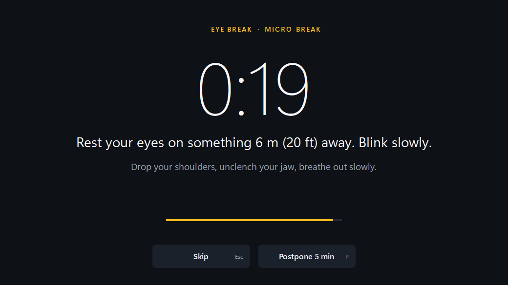

# NoDesk

Break reminder in your tray: micro, eye, rest and water breaks timed to your real keyboard and mouse activity.



- **Counts real work.** Timers only move while you type or use the mouse; idling as long as a break counts as that break.
- **Four kinds of break**, one calm full-screen countdown on every monitor, with a short tip. Esc skips, P postpones 5 minutes.
- **Stays out of the way.** Waits while a fullscreen app or presentation runs; pause it from the tray.
- **Daily stats** in the tray menu: active time and breaks taken, skipped and postponed.
- **Tiny.** One ~360 KB exe, about 1.5 MB of private memory and ~0% CPU at idle. No network, no camera, no account. Windows 10 (1703+) and 11, tested on 11.

## Install

**Download:** get `nodesk.exe` from the [latest release](https://github.com/seifsg/nodesk/releases/latest) and put it anywhere, for example `%LOCALAPPDATA%\NoDesk\`. No installer. The exe is not code-signed yet, so SmartScreen may warn: choose More info, then Run anyway.

**Or build it** (needs [Rust](https://rustup.rs) and the Visual Studio C++ Build Tools with the Windows SDK):

```bash
cargo install --git https://github.com/seifsg/nodesk
```

That puts `nodesk.exe` in `%USERPROFILE%\.cargo\bin`. From a clone, `cargo build --release` writes `target\release\nodesk.exe`.

## Run

Start `nodesk.exe`. It lives in the tray (on Windows 11, open the `^` overflow to find it, or drag it onto the taskbar). Hover it for the next break; right-click it for today's stats, **Pause breaks**, **Start with Windows** and **Quit**.

| Break | Every | Lasts |
|---|---|---|
| Micro-break | 10 min of work | 20 s |
| Eye break (20-20-20) | 20 min of work | 20 s |
| Rest break | 60 min of work | 5 min |
| Water break | 45 min of work | 15 s |

Stats live in `%APPDATA%\NoDesk\stats.tsv`, one row per day. Demo mode: set `NODESK_SPEED=60` before starting and work time runs 60 times faster, so the first micro-break comes after 10 seconds.

## Develop

```bash
cargo test
```

The landing page lives in `site/` (Vite + TypeScript): `npm ci`, then `npm run dev` to work on it or `npm run build` to write `dist/`. Pushing a `v*` tag builds `nodesk.exe` and attaches it to a GitHub Release.

🏭 Built with [AI Software Factory](https://softwarefactory.company/) by Seif
